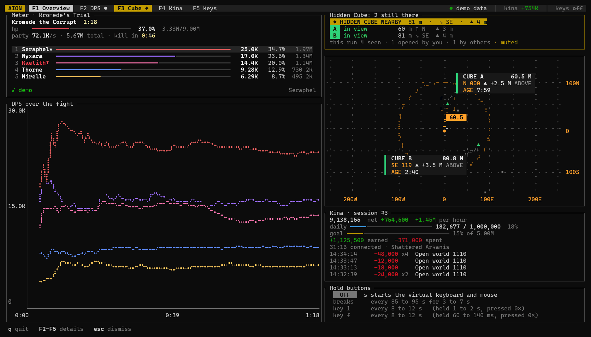

# AION

The Aion 2 tools in one terminal window: a DPS meter, the Hidden Cube alert with a radar, a kina tracker and hold
buttons.



It only reads the game's network traffic through Npcap. It never sends or changes packets and never touches the
game. Tools that read game traffic may still be against the game's terms of service, so use it at your own risk.

## Use

Run `make-shortcut.cmd` once, then start `AION.lnk`. It asks for administrator rights, which `^` needs while the
game runs as administrator.

| Key | |
| --- | --- |
| `F1` to `F5` | Overview, DPS, Cube, Kina, Keys |
| `^` | hold buttons on or off, also in game |
| `Ctrl+R` | new fight, also in game |
| `Ctrl+M` | mute or unmute the game, also in game |
| `q` | quit |

Each tab lists its keys at the bottom. `aion --help` lists the options, such as `--demo` and `--replay`.

## Build

Needs Rust (MSVC toolchain) and the [Npcap SDK](https://npcap.com/#download) unzipped into `vendor\npcap-sdk\`
(not included), and Npcap to run. Hold buttons need VIIPER's `viiper.exe` in `bin\` (not included).

```sh
cargo build --release
cargo test --workspace
```

## License

GPL-3.0-or-later. Not affiliated with NCSOFT.
